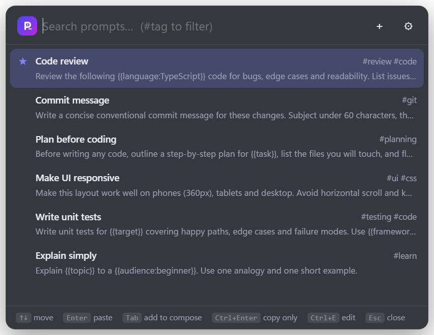
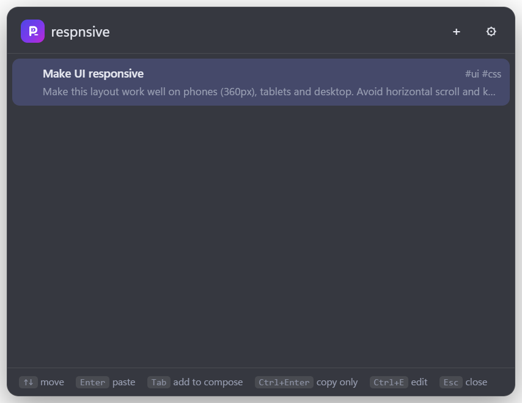
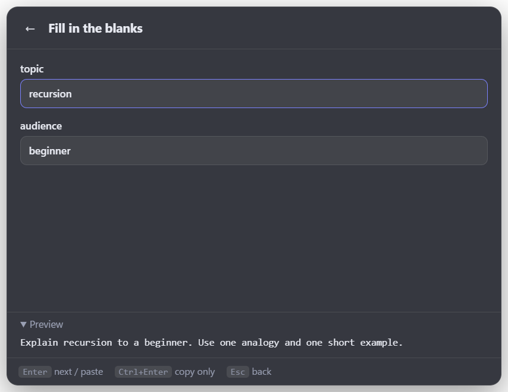
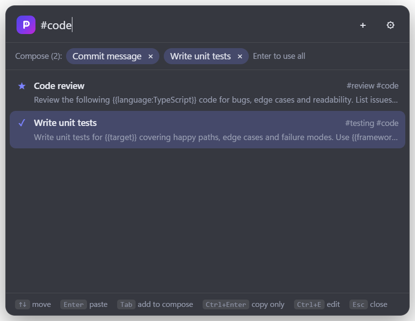
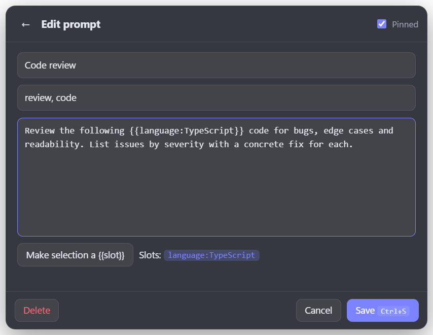

<div align="center">


# PromptDock

**Your best AI prompts, one shortcut away.**

Press a hotkey, type two words, hit Enter, and your prompt lands in ChatGPT, Claude, Antigravity,
your IDE, wherever your cursor is.




[**🌐 Open in your browser**](https://vassu-v.github.io/promptdock-intool/) ·
[**⬇ Download for Windows**](https://github.com/vassu-v/promptdock-intool/releases/latest) ·
[Quick start](#-quick-start) ·
[How to use it](#-how-to-use-it) ·
[User guide](docs/USER_GUIDE.md)

</div>

---

## 🤔 Why?

You've written the perfect prompt for code reviews, or commit messages, or "explain this like I'm
new here". Now it's buried in a notes file, so you rewrite it from memory, worse, every single time.

PromptDock keeps those prompts in a tiny translucent panel that floats above everything.
**No window switching. No copy-paste hunting. No account. No cloud.**

## ✨ What it does

| | |
|---|---|
| ⚡ **One hotkey, any app** | `Win+Alt+P` (or `⌘⌥P` on Mac) opens it over whatever you're doing |
| 🔎 **Search that forgives typos** | `respnsive` still finds *Make UI responsive*. Filter with `#tags` |
| 🧩 **Fill-in-the-blank prompts** | Write `{{file}}` or `{{tone:friendly}}`, and PromptDock asks for each value |
| 🧠 **Remembers your answers** | Blanks are pre-filled next time, stored only on your computer |
| 🧱 **Stack prompts together** | `Tab` a few prompts, then `Enter` to send them as one |
| 📋 **Pastes for you** | On Windows it types straight into the app you were in. On Mac/Linux it copies, then you press `⌘V` / `Ctrl+V` |
| 🪄 **Search by meaning** *(optional)* | "phone layout" → *Make UI responsive*. A 23 MB model that runs offline |
| 🫧 **Floating bubble** | A little `P_` bubble you can drag anywhere. Click it to open |
| 🎓 **Built-in tour** | A 5-step walkthrough on first launch |

## 🚀 Quick start

<details open>
<summary><b>🌐 In the browser: nothing to install</b></summary>

Open **[vassu-v.github.io/promptdock-intool](https://vassu-v.github.io/promptdock-intool/)** on any computer or phone.

- Your prompts are saved **in that browser only**. No account, nothing uploaded.
- Pick a prompt and it's **copied**; paste it with `Ctrl+V` / `⌘V`.
- Shortcuts: `/` search, `Alt+N` new, `Ctrl+E` edit, `Ctrl+,` settings.
- Clearing your browser data deletes your prompts, so use **Settings → Export JSON** now and then.
- Want a global hotkey and auto-paste into any app? Use the desktop version below.

</details>

<details>
<summary><b>🪟 Windows: desktop installer (hotkey + auto-paste)</b></summary>

1. Grab **`PromptDock-Setup-x.y.z.exe`** from the [latest release](https://github.com/vassu-v/promptdock-intool/releases/latest).
   Want zero install? Take **`PromptDock-Portable-x.y.z.exe`** instead.
2. Windows may say *"Windows protected your PC"*. That's only because the app isn't code-signed.
   Click **More info → Run anyway**.
3. The tour pops up. Follow it, or press `Win+Alt+P` and start typing.

</details>

<details>
<summary><b>🍎 macOS: run from source</b></summary>

> Not tested on a Mac yet. If you try it, tell us how it went!

1. Install **[Node.js](https://nodejs.org)**: click the LTS button, then run the normal Mac installer.
2. Get the code: **Code → Download ZIP** on this page and unzip it, or run `git clone https://github.com/vassu-v/promptdock-intool.git`.
3. Open **Terminal**, type `bash ` (with a space), drag **`PromptDock.command`** from the folder into the window, and press Enter.
   - First run: it downloads what it needs (~600 MB, a few minutes). After that it starts instantly.
   - Used `git clone`? Then you can simply double-click `PromptDock.command` next time.
4. Press **`⌘ Cmd + ⌥ Option + P`**, pick a prompt, press Enter, then **`⌘V`** to paste.

Bonus: running from source means no "app is damaged" or unidentified-developer warnings.

</details>

<details>
<summary><b>🐧 Linux: run from source</b></summary>

> Not tested on Linux yet. Works best on X11; on Wayland your desktop may block global hotkeys.

```bash
git clone https://github.com/vassu-v/promptdock-intool.git
cd promptdock-intool
./promptdock.sh
```

Needs **Node.js 22+**. Open it with **`Super+Alt+P`**, choose a prompt, then paste with **`Ctrl+V`**.

</details>

<details>
<summary><b>🪟 Windows: run from source</b></summary>

Install **[Node.js](https://nodejs.org)** 22+, download or clone this repo, and double-click **`PromptDock.cmd`**.

</details>

## 🎮 How to use it

<table>
<tr>
<td width="50%"></td>
<td width="50%"></td>
</tr>
<tr>
<td><b>1 · Find it.</b> Type a few letters, typos welcome. <code>↑</code> <code>↓</code> to pick, <code>Enter</code> to use.</td>
<td><b>2 · Fill the blanks.</b> <code>Enter</code> jumps to the next blank. The last <code>Enter</code> pastes (or copies) the finished prompt.</td>
</tr>
<tr>
<td></td>
<td></td>
</tr>
<tr>
<td><b>3 · Stack them.</b> <code>Tab</code> adds prompts to the compose bar, and <code>Enter</code> sends them all in order.</td>
<td><b>4 · Make your own.</b> <code>Ctrl+N</code> for new, <code>Ctrl+E</code> or right-click to edit. Select a word and click <i>Make selection a {{slot}}</i>.</td>
</tr>
</table>

### ⌨️ Cheat sheet

| Windows / Linux | macOS | Does |
|---|---|---|
| `Win+Alt+P` | `⌘⌥P` | Open / close PromptDock |
| `↑` `↓` then `Enter` | same | Use the highlighted prompt |
| `Ctrl+Enter` | `⌘Enter` | Copy only, don't paste |
| `Tab` | same | Add to / remove from the compose bar |
| `Ctrl+N` · `Ctrl+E` · `Ctrl+,` | `⌘N` · `⌘E` · `⌘,` | New · Edit · Settings |
| `Esc` | same | Clear search, then close |

### 🧩 Writing a prompt with blanks

```text
Review this {{language:TypeScript}} code for {{focus:bugs and edge cases}}.
Explain the fixes to a {{audience}}.
```

`{{name}}` is a blank. `{{name:default}}` is a blank with a default you keep with one `Enter`.
Names can be in any language: `{{नाम}}` works too.

> **Hotkey note:** `Ctrl+Win+P` is reserved by Windows on many PCs, so PromptDock picks the first free
> one: `Win+Alt+P`, then `Ctrl+Alt+P`, then `Ctrl+Shift+Space`. Change it any time in ⚙ Settings.

## 🔧 How it works

```text
  hotkey / bubble / tray
          │
          ▼
  ┌─────────────────┐   search · fill · compose  ┌──────────────────────┐
  │  Panel (HTML)   │ ─────────────────────────► │  Main process        │
  │  src/renderer   │ ◄───────────────────────── │  src/main            │
  └─────────────────┘          results           │  • SQLite (sql.js)   │
                                                 │  • optional AI model │
                                                 │  • clipboard + paste │
                                                 └──────────┬───────────┘
                                   Windows: refocus the app │ you were in, send Ctrl+V
                                   macOS/Linux: copy only   ▼
                                                     your chat box ✨
```

- An **Electron** app with frameless, translucent, always-on-top windows.
- **SQLite** (via WebAssembly) in one local file. Nothing ever leaves your machine.
- **Semantic search** (opt-in) runs `all-MiniLM-L6-v2` locally on the CPU.
- `src/core` has no Electron dependency, so a web or browser-extension version can reuse it later.

Curious about the internals, tests, or building it yourself? See **[docs/DEVELOPMENT.md](docs/DEVELOPMENT.md)**.

## ❓ FAQ

<details><summary><b>Is my data sent anywhere?</b></summary>

No. Prompts, settings and remembered values live in one local SQLite file. The only network request
the app ever makes is the one-time model download, and only if you turn on semantic search.
</details>

<details><summary><b>Why does Windows warn me when I install it?</b></summary>

The installer isn't signed with a paid certificate, because this is a free internal tool.
Click **More info → Run anyway**.
</details>

<details><summary><b>It copied but didn't paste?</b></summary>

Some apps run as administrator, and Windows blocks other apps from typing into them. Just press `Ctrl+V`.
On macOS and Linux, pasting is always manual for now (`⌘V` / `Ctrl+V`).
</details>

<details><summary><b>How do I move my prompts to another computer?</b></summary>

⚙ Settings → **Export JSON**, then **Import JSON** on the other machine. Duplicates are skipped.
</details>

<details><summary><b>Can I change the shortcut?</b></summary>

⚙ Settings → click the hotkey box → press your combo. If another app already owns it, PromptDock says so and keeps the old one.
</details>

More answers in the **[User Guide](docs/USER_GUIDE.md#9-troubleshooting)**.

## 🗺️ Roadmap

- [x] Search, slots, compose, editor, tour, bubble, tray, import/export
- [x] Optional offline semantic search
- [x] Windows installer + portable build
- [ ] Auto-paste on macOS (needs a Mac tester 👀) and Linux (X11)
- [ ] macOS `.dmg` and Linux AppImage builds
- [ ] Shareable prompt packs for the team
- [x] Web version (GitHub Pages)
- [ ] Installable web app (PWA) and browser extension

## 🤝 Feedback

This is a free internal tool for friends and teammates. Found a bug or have an idea?
[Open an issue](https://github.com/vassu-v/promptdock-intool/issues). Mac and Linux reports are extra welcome.

<div align="center">
<sub>Made with ☕ and way too many re-typed prompts · MIT licensed</sub>
</div>
